# MiniPay

A simulated cross-border payment network, built as a learning project. Three banks exchange
ISO 20022 messages over a simulated network. Each runs its own ledger, payment hub, reference
data, sanctions screening and nostro reconciliation. A simulated central bank runs the euro clearing
and settlement systems they settle through: an RTGS, a deferred net settlement ACH and an instant
scheme.

| Bank | City | BIC | Role | Port | Database |
|---|---|---|---|---|---|
| Bank A | Kuala Lumpur | `MNPAMYKLXXX` | Originating bank | 8081 | `localhost:5433/bank_a` |
| Bank B | Frankfurt | `MNPBDEFFXXX` | EUR correspondent | 8082 | `localhost:5434/bank_b` |
| Bank C | London | `MNPCGB2LXXX` | Beneficiary bank (GBP) | 8083 | `localhost:5435/bank_c` |
| Central bank | Frankfurt | `MNCBDEFFXXX` | Runs T2 (RTGS), MiniPay Net (DNS) and MiniPay Instant | 8084 | `localhost:5436/operator` |

The banks, BICs, IBANs and customers are all fictional. BICs and IBANs have valid formats (IBAN check digits included).

**Status:** all milestones (M0–M8) are done. See the [delivery plan](#milestones).

## Architecture at a glance

- **One application, four instances.** `backend/bank-app` assembles every module. It runs once per
  institution, chosen by Spring profile (`bank-a`, `bank-b`, `bank-c`, `operator`), each with its
  own PostgreSQL. No instance reads another's database.
- **Modules with hard boundaries.** Each module has a public `api` package and a private `internal`
  package (ArchUnit enforces it), and owns one database schema with its own Flyway migrations.
- **The network is Kafka.** Every institution has an inbox topic (`minipay.network.<BIC8>`). A
  message leaves a bank only through its transactional outbox, in the same database transaction as the
  status change that produces it, and the relay publishes it. Banks the simulator does not run (Paris,
  Brussels) share `minipay.network.external`.
- **Exactly once, built from at least once.**
  - Kafka delivers at least once.
  - Receivers de-duplicate: by the event id, and by (sender, MsgId) in the message store.
  - Every write API takes an `Idempotency-Key`.
  - Every ledger call carries a key derived from the payment and the step, so a step that crashes can
    simply run again.
- **What a payment goes through**:
  - **at the sending bank:** validation against dated reference data, sanctions screening, a funds
    hold, routing on the value date, booking, then a pacs.008 on the network;
  - **at every bank on the way:** the same checks, then its leg is booked;
  - **outcomes:** pacs.002 confirmations and rejections, and pacs.004 returns, travel back hop by hop.
- **How it settles**, chosen by routing rule and service level:
  - **correspondent accounts** (nostro/vostro): serial or cover;
  - **T2:** gross, with a liquidity queue;
  - **MiniPay Net:** netted in cycles;
  - **MiniPay Instant:** within 10 seconds, on prefunded positions.
- **Reconciliation.** Every night each servicer sends a camt.053 statement of every account it keeps
  for another bank. The owner matches it against its own books, and its people work what does not match.

The decisions behind each part are in [docs/adr](docs/adr): one ADR per milestone.

## Repository layout

```
docs/adr/              Architecture Decision Records (ADR-001 architecture, 002 ledger, 003 payment hub, 004 reference data, 005 messaging, 006 network, 007 compliance, 008 settlement, 009 reconciliation)
docker-compose.yml     4 × PostgreSQL 16 (one per bank, one for the central bank) + Kafka (KRaft)
backend/               Maven multi-module, Java 21, Spring Boot 3.5
  common/              Money, ISO 4217 minor units, UETR, BIC — no framework code
  ledger/              Double-entry ledger (M1)
  payment-hub/         Payment lifecycle, state machine, idempotent API, outbox → Kafka (M2)
  refdata/             Effective-dated BIC directory, IBAN registry, calendars, cut-offs, routing (M3)
  messaging/           pacs.008/002/004/009, camt.053/054, MT103 translation, raw message store (M4)
  network-simulator/   The network between the banks: inboxes and the UETR tracker (M5)
  compliance/          Sanctions screening against effective-dated lists, cases, four-eyes release (M6)
  settlement/          The central bank's clearing systems: T2 queue, DNS netting, instant timeouts (M7)
  recon/               Nostro reconciliation: camt.053 statements, matching, breaks (M8)
  bank-app/            Spring Boot app assembling the modules; run with profile bank-a|bank-b|bank-c|operator
frontend/ops-console/  React + TypeScript + Vite + Tailwind + TanStack Query/Table
```

## Conventions

These rules are non-negotiable. The reasoning behind them is in [ADR-001](docs/adr/ADR-001-architecture.md) and [ADR-002](docs/adr/ADR-002-ledger-design.md).

1. **Money** is `Money` (a `BigDecimal` plus an ISO 4217 currency), at the currency's own number of decimals: JPY 0, EUR 2, KWD 3.
   - Input with too many decimals is rejected; computed amounts round HALF_EVEN.
   - Never use `double` or `float`. JSON carries amounts as strings.
2. **Postings are append-only.** The database rejects UPDATE and DELETE; corrections are REVERSAL entries.
3. **Every journal entry balances** per currency (and per balance type). This is checked in the domain *and* by a deferred constraint trigger.
4. **Balances change in the same transaction as their postings.** Accounts are locked in ascending id order, so transactions never deadlock.
5. **Every write API needs an `Idempotency-Key` header.**
   - The same key with the same body replays the original result (200 + `Idempotent-Replayed: true`).
   - The same key with a different body is **422**.
6. **No direct Kafka publishing from business code.** Use the transactional outbox and its relay; ArchUnit enforces this.
7. **Every payment status change is validated by a state machine and recorded in history.**
8. **Raw messages are stored exactly as received or sent**, alongside the parsed fields; the database checks their SHA-256.
9. **Reference data is effective-dated.** Every lookup takes a date; rows are end-dated, never edited or deleted.
10. **Timestamps are `TIMESTAMPTZ` in UTC; value dates are `DATE`.** "Today" follows the bank's time zone; a cut-off is wall-clock time in its settlement scheme's time zone (T2: Frankfurt).
11. **Real ISO codes:** reason codes (AM04, AC01 …), charge bearer (DEBT/CRED/SHAR), valid-format BICs and IBANs.
12. **Module boundaries:**
    - Modules talk through `com.minipay.<module>.api` only; `internal` packages are private (ArchUnit).
    - Each module owns one Postgres schema and runs its own Flyway migrations.
13. **Tests come with the code.** Integration tests use Testcontainers (real PostgreSQL), never H2.

## Running it

**Prerequisites:** Java 21, Docker (also for the tests: Testcontainers starts real PostgreSQL and
Kafka), Node 20 or later, and `jq` for the sample calls. The Maven wrapper (`./mvnw`) downloads Maven
itself. If `java -version` is not 21, point `JAVA_HOME` at a JDK 21. With Homebrew on macOS:
`export JAVA_HOME=/opt/homebrew/opt/openjdk@21`.

```bash
# 1. Infrastructure: four Postgres databases (three banks, the central bank) and Kafka
docker compose up -d

# 2. Build and run all tests: unit + Testcontainers integration tests + ArchUnit
cd backend
./mvnw verify

# 3. Run the four institutions, each in its own terminal (install once so bank-app can resolve the modules)
./mvnw install -DskipTests
./mvnw -pl bank-app spring-boot:run -Dspring-boot.run.profiles=bank-a     # :8081
./mvnw -pl bank-app spring-boot:run -Dspring-boot.run.profiles=bank-b     # :8082
./mvnw -pl bank-app spring-boot:run -Dspring-boot.run.profiles=bank-c     # :8083
./mvnw -pl bank-app spring-boot:run -Dspring-boot.run.profiles=operator   # :8084, the central bank
#   or: ./mvnw -pl bank-app clean package -DskipTests, then
#       java -jar bank-app/target/bank-app-0.1.0-SNAPSHOT.jar --spring.profiles.active=bank-a  (and so on)
#   (rebuild the jar with `clean package` after changing any module: Spring Boot only repackages it when
#    bank-app itself changed, so it can keep stale module jars)
#   Bank A alone works for the ledger, payments and reference data; payments leave it but nobody answers.

# 4. Ops console (another terminal)
cd frontend/ops-console
npm install
npm run dev        # http://localhost:5173
```

On first start each instance **seeds** its chart of accounts and opening balances through the
ledger API, and a bank its routing table through the reference data import API. The seed lists are in
`bank-app/src/main/resources/application-{bank-a,bank-b,bank-c,operator}.yml`, with the settings each
profile overrides (BIC, time zone, fees, nostro master data for reconciliation, the central bank's
participants). Seeding is idempotent, so restarting changes nothing.

The shared reference data comes with the refdata module's Flyway migrations: the BIC directory, the
IBAN registry, calendars, cut-offs and clearing systems. So do the simulated sanctions lists, with the
compliance module's.

- **API docs:** http://localhost:8081/swagger-ui.html (each instance on its own port)
- **Health:** http://localhost:8081/actuator/health
- **Start from scratch:** `docker compose down -v` deletes all four databases.

**Timers** run by themselves:

- the recovery sweeper, every bank, for payments stuck mid-pipeline;
- the outbox relay;
- the central bank: instant timeouts (4× a second), DNS cycle closes and the T2 cut-off (every 5 s),
  and queue retries;
- every servicer: yesterday's camt.053 statements, after its own midnight.

### Sample calls (Bank A)

Account ids are generated, so look them up by account number first (requires `jq`).

The idempotency keys below (`demo-*`) are fixed. If you run the script a second time, the ledger
does exactly what it should: identical requests are replayed and nothing is posted twice, and a
key reused for a different hold (step 4) gets a 422. To see fresh postings, change the keys or
reset the databases with `docker compose down -v`.

```bash
A=localhost:8081/api/ledger
acct() { curl -s "$A/accounts" | jq -r --arg n "$1" '.[] | select(.accountNumber==$n) | .id'; }
CUS=$(acct 514087234412)     # Selangor Precision Components Sdn Bhd (EUR customer)
NOSTRO=$(acct 1101-EUR-MNPB) # our EUR nostro at Bank B
FEES=$(acct 4020-FEE-EUR)

# All accounts with booked / reserved / available
curl -s "$A/accounts" | jq '.[] | {accountNumber, type, booked: .booked.amount, available: .available.amount}'

# 1. Reserve funds for an outgoing payment (payment state FUNDS_RESERVED)
curl -s -X POST $A/reservations -H 'Content-Type: application/json' -H 'Idempotency-Key: demo-hold-1' \
  -d "{\"accountId\": $CUS, \"amount\": {\"amount\": \"48250.00\", \"currency\": \"EUR\"}, \"reason\": \"INV-HF-2026-1187\"}" | tee /tmp/hold.json; echo
HOLD=$(jq -r .id /tmp/hold.json)

# 2. Send it again: same key + same body → 200 and Idempotent-Replayed: true, nothing new is posted
curl -si -X POST $A/reservations -H 'Content-Type: application/json' -H 'Idempotency-Key: demo-hold-1' \
  -d "{\"accountId\": $CUS, \"amount\": {\"amount\": \"48250\", \"currency\": \"EUR\"}, \"reason\": \"INV-HF-2026-1187\"}" | grep -i replayed

# 3. Same key, different body → 422 IDEMPOTENCY_KEY_REUSED
curl -s -X POST $A/reservations -H 'Content-Type: application/json' -H 'Idempotency-Key: demo-hold-1' \
  -d "{\"accountId\": $CUS, \"amount\": {\"amount\": \"1.00\", \"currency\": \"EUR\"}}" | jq

# 4. Book it: release the hold + debit the customer, credit our nostro (one transaction)
curl -s -X POST $A/reservations/$HOLD/settle -H 'Content-Type: application/json' -H 'Idempotency-Key: demo-settle-1' \
  -d "{\"creditAccountId\": $NOSTRO, \"narrative\": \"To Harlow & Finch Engineering Ltd\"}" | jq .status

# 5. Charge a fee, then reverse it (the original stays; a mirror entry is added)
FEE=$(curl -s -X POST $A/journal-entries -H 'Content-Type: application/json' -H 'Idempotency-Key: demo-fee-1' \
  -d "{\"entryType\": \"FEE\", \"narrative\": \"Outward transfer fee (SHAR)\", \"postings\": [
        {\"accountId\": $CUS,  \"direction\": \"D\", \"amount\": {\"amount\": \"20.00\", \"currency\": \"EUR\"}},
        {\"accountId\": $FEES, \"direction\": \"C\", \"amount\": {\"amount\": \"20.00\", \"currency\": \"EUR\"}}]}" | jq -r .id)
curl -s -X POST $A/journal-entries/$FEE/reversal -H 'Idempotency-Key: demo-rev-1' | jq '{entryType, reversesEntryId}'

# 6. Try to overspend → 422 with ISO reason code AM04 (InsufficientFunds)
curl -s -X POST $A/reservations -H 'Content-Type: application/json' -H 'Idempotency-Key: demo-big-1' \
  -d "{\"accountId\": $CUS, \"amount\": {\"amount\": \"99999999.00\", \"currency\": \"EUR\"}}" | jq '{status, reasonCode, detail}'

# 7. Today's statement (business date in Asia/Kuala_Lumpur) and the end-of-day integrity check
curl -s "$A/accounts/$CUS/statement" | jq '{openingBooked, closingBooked, lines: [.lines[] | {entryType, debit, credit, balance}]}'
curl -s $A/integrity | jq '{ok, journalEntries, postings, trialBalance}'
```

Then open http://localhost:5173/accounts?account=514087234412 to see the same activity in the ops console.

### Sample calls: payments (Bank A)

```bash
P=localhost:8081/api/payments

# 1. Send EUR 48,250 to Harlow & Finch in London. Bank A has no EUR account with Bank C, so routing
#    rule R-003 sends it serially via its EUR correspondent, Bank B. Our EUR 20 fee is charged on top (SHAR).
curl -s -X POST $P -H 'Content-Type: application/json' -H 'Idempotency-Key: demo-pay-1' -d '{
  "debtorAccount": "514087234412", "creditorName": "Harlow & Finch Engineering Ltd",
  "creditorAccount": "GB67 MNPC 4005 1271 5200 93", "creditorAgentBic": "MNPCGB2LXXX",
  "amount": {"amount": "48250.00", "currency": "EUR"}, "chargeBearer": "SHAR",
  "endToEndId": "INV-HF-2026-1187", "remittanceInformation": "INV-HF-2026-1187 CNC spindle assemblies"}' \
  | tee /tmp/pay.json | jq '{uetr, status, instructionId, instructedAgentBic, routingRuleId, chargesAmount, valueDate}'
UETR=$(jq -r .uetr /tmp/pay.json); ID=$(jq -r .id /tmp/pay.json)

# 2. Its audit trail and the ledger entries it caused (hold, release, principal, fee)
curl -s $P/$UETR | jq '.history[] | {to, actor, detail}'
curl -s "localhost:8081/api/ledger/journal-entries?paymentId=$ID" | jq '.[] | {entryType, narrative}'

# 3. The network answers. With Banks B and C running, Bank B accepts it (ACSP) and passes it on; Bank C
#    credits Harlow & Finch and confirms (ACSC), relayed by Bank B. With Bank A alone it stays SENT.
sleep 4; curl -s $P/$UETR | jq -r '.payment.status, (.history[-2:][] | "\(.to): \(.detail)")'

# 4. Playing a bank by hand (pacs.002/pacs.004 injected by the console) is only for banks the simulator
#    does not run; Bank B answers for itself → 409
curl -s -X POST $P/$UETR/network-events -H 'Content-Type: application/json' -H 'Idempotency-Key: demo-ack-2' \
  -d '{"type": "ACCEPTED"}' | jq '{status, code, detail}'

# 5. A payment the debtor cannot afford is stored and REJECTED with AM04 — not lost, not half-done
curl -s -X POST $P -H 'Content-Type: application/json' -H 'Idempotency-Key: demo-pay-2' -d '{
  "debtorAccount": "514066120983", "creditorName": "Rheinwerk Logistik GmbH",
  "creditorAccount": "DE34500100600533190042", "creditorAgentBic": "MNPBDEFFXXX",
  "amount": {"amount": "9310.75", "currency": "EUR"}, "chargeBearer": "SHAR"}' | jq '{status, rejectionReason}'

# 6. The events on Kafka (one per status change, keyed by UETR, with an event-id header)
docker exec minipay-kafka /opt/kafka/bin/kafka-console-consumer.sh --bootstrap-server localhost:9092 \
  --topic minipay.MNPAMYKLXXX.payment-events --from-beginning --timeout-ms 10000 --property print.headers=true
```

In the console: http://localhost:5173/payments, then open a payment to see its lifecycle, ledger
postings, messages, screening, route and audit log, or use **Create payment** with the scenario presets.

### Sample calls: reference data (Bank A)

Run against a fresh database (`docker compose down -v` first), because step 5 publishes a release.
Its key makes a second run replay, but after a week the dates in it are in the past.

```bash
R=localhost:8081/api/refdata

# 1. Current data version, and the BIC directory as of a date (try a date before 2026-10-02:
#    the Berlin branch still has its old name)
curl -s $R | jq '{dataVersion, institutions, routingRules}'
curl -s "$R/bics/MNPBDEFF100/history" | jq '.[] | {institutionName, validFrom, validTo}'
curl -s "$R/bics/MNPXNL2AXXX?date=2027-01-04" | jq '{status, detail}'   # gone after 2026-12-31 → 404

# 2. IBAN validation reports every check (one wrong digit → mod-97 fails, expected digits shown)
curl -s $R/iban/GB97MNPC60161331926819 | jq '{valid, checks: [.checks[] | "\(.outcome) \(.name): \(.detail)"]}'

# 3. Value dates: TARGET is closed on 25 and 26 December, so Christmas Day rolls to Monday 28th.
#    Cut-offs are per scheme, in the scheme's own time zone (shown here as UTC instants).
curl -s "$R/value-date?currency=EUR&date=2026-12-25" | jq '{valueDate, reasons}'
curl -s $R/cutoffs | jq '.[] | {schemeName, currency, settlementDate, cutoff}'

# 4. Routing is evaluated on the value date: Paris goes serial until 30 Nov, by cover from 1 Dec
for d in 2026-11-30 2026-12-01; do
  curl -s "$R/routes?bic=MNPEFRPPXXX&currency=EUR&date=$d" \
    | jq -c '{valueDate, rule: .route.rule.ruleId, method: .route.rule.method, instructedAgent: .route.instructedAgentBic}'
done

# 5. Publish a change as a new release: Belgium moves from serial to cover in a week's time.
#    The superseded rule R-004 is end-dated the day before, in the same transaction.
FROM=$(date -d '+7 days' +%F 2>/dev/null || date -v+7d +%F)
curl -s -X POST $R/routing-rules -H 'Content-Type: application/json' -H 'Idempotency-Key: demo-rule-1' -d "{
  \"destination\": \"MNPDBEBB*\", \"currency\": \"EUR\", \"method\": \"COVER\", \"nextHopBic\": \"MNPBDEFFXXX\",
  \"settlementAccount\": \"1101-EUR-MNPB\", \"priority\": 20, \"effectiveFrom\": \"$FROM\", \"supersedes\": \"R-004\",
  \"publishedBy\": \"r.lim\", \"approvedBy\": \"a.wong\", \"description\": \"Belgium by cover\"}" | jq '{ruleId, effectiveFrom, releaseVersion}'
curl -s $R/routing-rules | jq -c '.[] | select(.destination == "MNPDBEBB*") | {ruleId, method, effectiveFrom, effectiveTo}'

# 6. Four-eyes: the author cannot approve their own change → 422
curl -s -X POST $R/routing-rules -H 'Content-Type: application/json' -H 'Idempotency-Key: demo-rule-2' -d "{
  \"destination\": \"MNPDBEBB*\", \"currency\": \"EUR\", \"method\": \"SERIAL\", \"nextHopBic\": \"MNPBDEFFXXX\",
  \"settlementAccount\": \"1101-EUR-MNPB\", \"priority\": 30, \"effectiveFrom\": \"$FROM\",
  \"publishedBy\": \"r.lim\", \"approvedBy\": \"r.lim\", \"description\": \"Self-approved\"}" | jq '{status, code}'

# 7. The payment hub uses all of it: a Saturday request executes on Monday; an IBAN of Bank C sent
#    to a Belgian bank is rejected AC03
P=localhost:8081/api/payments
curl -s -X POST $P -H 'Content-Type: application/json' -H 'Idempotency-Key: demo-pay-sat' -d '{
  "debtorAccount": "514087234412", "creditorName": "Atelier Lumière SARL",
  "creditorAccount": "FR76 3000 6000 0112 3456 7890 189", "creditorAgentBic": "MNPEFRPPXXX",
  "amount": {"amount": "1250.00", "currency": "EUR"}, "chargeBearer": "SHAR", "requestedExecutionDate": "2026-12-05"}' \
  | jq '{status, requestedExecutionDate, executionDate}'
curl -s -X POST $P -H 'Content-Type: application/json' -H 'Idempotency-Key: demo-pay-ac03' -d '{
  "debtorAccount": "514087234412", "creditorName": "Brouwerij De Klok NV",
  "creditorAccount": "GB67 MNPC 4005 1271 5200 93", "creditorAgentBic": "MNPDBEBBXXX",
  "amount": {"amount": "500.00", "currency": "EUR"}, "chargeBearer": "SHAR"}' | jq '{status, rejectionReason, rejectionDetail}'
```

In the console: http://localhost:5173/reference-data. Change **As of** to see the directory, the IBAN
registry and the routing table as they were, or will be, on another date. **Overview** shows today's
figures and each currency's cut-off in the bank's local time.

### Sample calls: messages (Bank A)

Run with Banks A and B (and C) up. Every step can be run again: the keys include a timestamp.

```bash
P=localhost:8081/api/payments; M=localhost:8081/api/messages; RUN=$(date +%s)

# 1. Send a payment: the send step issues one pacs.008 to the next bank, stored byte for byte
UETR=$(curl -s -X POST $P -H 'Content-Type: application/json' -H "Idempotency-Key: m4-pay-$RUN" -d '{
  "debtorAccount": "514087234412", "creditorName": "Harlow & Finch Engineering Ltd",
  "creditorAccount": "GB67 MNPC 4005 1271 5200 93", "creditorAgentBic": "MNPCGB2LXXX",
  "amount": {"amount": "1250.00", "currency": "EUR"}, "chargeBearer": "SHAR",
  "endToEndId": "INV-HF-2026-1201", "remittanceInformation": "INV-HF-2026-1201 spindle bearings"}' | jq -r .uetr)
curl -s "$M?uetr=$UETR" | jq -c '.[] | {type, direction, msgId, receiverBic, amount: .amount.amount}'
ID=$(curl -s "$M?uetr=$UETR" | jq -r '.[0].id')
curl -s $M/$ID/raw | sed -n '1,4p'

# 2. The same payment as MT103, and what the translation keeps, changes or loses
curl -s $M/$ID/mt103 | jq -r '.target'
curl -s $M/$ID/mt103 | jq -c '.fields[] | select(.fidelity != "EQUIVALENT") | {mtTag, mxPath, fidelity, note}'

# 3. Bank B acknowledges it over the network: a pacs.002 ACSP, stored as received
sleep 3
curl -s "$M?uetr=$UETR" | jq -c '.[] | {type, direction, msgId, senderBic, status, originalMsgId}'

# 4. Resend Bank B's pacs.002 to the inbound endpoint: recognised by sender + MsgId, nothing changes
ACK=$(curl -s "$M?uetr=$UETR" | jq -r '[.[] | select(.type == "PACS_002" and .status == "ACSP")][0].id')
curl -s $M/$ACK/raw > /tmp/pacs002.xml
curl -si -X POST $P/inbound -H 'Content-Type: application/xml' -H "Idempotency-Key: m4-resend-$RUN" \
  --data-binary @/tmp/pacs002.xml | grep -iE "^HTTP|replayed"

# 5. A broken message is refused (422) but kept, marked INVALID, with every error listed
sed 's/<pacs:TxSts>ACSP/<pacs:TxSts>NOPE/; s/-002-/-002-X/g' /tmp/pacs002.xml > /tmp/bad.xml
curl -s -X POST $P/inbound -H 'Content-Type: application/xml' -H "Idempotency-Key: m4-bad-$RUN" \
  --data-binary @/tmp/bad.xml | jq -c '{status, code, detail}'

# 6. Bank B issues (but does not send) a camt.053 for Bank A's vostro; the nightly statements are sent
#    by reconciliation, see "Sample calls: reconciliation"
VOSTRO=$(curl -s "localhost:8082/api/ledger/accounts?type=VOSTRO" | jq '.[0].id')
curl -s -X POST localhost:8082/api/messages/camt053 -H 'Content-Type: application/json' \
  -H "Idempotency-Key: m4-stmt-$RUN" -d "{\"accountId\": $VOSTRO}" | jq -c '{type, msgId, receiverBic, account, closingBalance: .amount}'
```

In the console, open the payment and its **Messages** tab, then switch a pacs.008 to **MT103
side-by-side**. **Create payment** shows the pacs.008 the form would produce, and **Accounts &
ledger** issues a camt.053 for a customer or vostro account.

### Sample calls: the network (all three banks)

Start all three banks (bank-a, bank-b and bank-c, in three terminals). Payments then travel between
them over Kafka; nothing below calls a bank on another bank's behalf, except the return in step 6,
which is Bank C's own decision.

```bash
A=localhost:8081/api; B=localhost:8082/api; C=localhost:8083/api; RUN=$(date +%s)
pay() { curl -s -X POST $A/payments -H 'Content-Type: application/json' -H "Idempotency-Key: m5-$1-$RUN" -d "{
  \"debtorAccount\": \"$2\", \"creditorName\": \"Harlow & Finch Engineering Ltd\", \"creditorAccount\": \"$3\",
  \"creditorAgentBic\": \"$4\", \"amount\": {\"amount\": \"$5\", \"currency\": \"$6\"}, \"chargeBearer\": \"SHAR\",
  \"remittanceInformation\": \"M5 $1\"}" | jq -r .uetr; }

# 1. Serial: Bank A → Bank B → Bank C (head office), EUR. Each bank takes its charge on the way.
SERIAL=$(pay serial 514087234412 GB23MNPC40051288779901 MNPCGB2LXXX 1000.00 EUR)
# 2. Cover: the pacs.008 goes straight to Bank C's Manchester branch, the money through Bank B (pacs.009 COV).
COVER=$(pay cover 514087234412 GB23MNPC40051288779901 MNPCGB2L200 2000.00 EUR)
# 3. Direct: Bank A → Bank C in GBP, on Bank A's vostro at Bank C.
DIRECT=$(pay direct 514055218840 GB67MNPC40051271520093 MNPCGB2LXXX 500.00 GBP)
sleep 4

# 4. The same payment as each bank sees it
for u in $SERIAL $COVER $DIRECT; do
  echo "$u  A: $(curl -s $A/payments/$u | jq -r .payment.status)  B: $(curl -s $B/payments/$u | jq -r '.payment.status // "—"')  C: $(curl -s $C/payments/$u | jq -r '.payment.status // "—"')"
done

# 5. The tracker: the route end to end, with every deduction
curl -s $A/tracker/$SERIAL | jq -c '{status, method, hops: [.hops[] | "\(.fromBic)→\(.toBic) \(.amount.amount) \(.reply)"], deductions: [.deductions[] | "\(.agentBic) \(.amount.amount)"], credited: .creditedAmount.amount}'
curl -s $A/tracker/$COVER | jq -c '{status, method, hops: [.hops[] | "\(.fromBic)→\(.toBic) \(.reply)"], cover: [.coverLegs[] | "\(.type) \(.fromBic)→\(.toBic)"], credited: .creditedAmount.amount}'

# 6. Bank C returns the serial payment (account closed); the return travels back through Bank B
curl -s -X POST $C/payments/$SERIAL/return -H 'Content-Type: application/json' -H "Idempotency-Key: m5-ret-$RUN" \
  -d '{"reasonCode": "AC04", "additionalInformation": "Account closed"}' | jq -c '{status}'
sleep 3
curl -s $A/tracker/$SERIAL | jq -c '{status, returnPath: [.returnPath[] | "\(.fromBic)→\(.toBic) \(.amount.amount)"]}'
echo "SERIAL=$SERIAL COVER=$COVER"
```

In the console: open a payment and look at **Payment route**, or open **UETR tracker** and pick any
payment the network carried. Switch the console to Bank B or Bank C to see the same payment from their
side: incoming, passed on, or credited.

### Sample calls: sanctions screening (all three banks)

The (simulated, fictional) sanctions lists hold names that some creditors below resemble. Every bank
screens every payment; a hit holds it in `HELD_COMPLIANCE` until officers decide. A release of a hit
scoring 90 or more needs a second person.

```bash
A=localhost:8081/api; B=localhost:8082/api; C=localhost:8083/api; RUN=$(date +%s)
pay() { curl -s -X POST $A/payments -H 'Content-Type: application/json' -H "Idempotency-Key: m6-$1-$RUN" -d "{
  \"debtorAccount\": \"$2\", \"creditorName\": \"$3\", \"creditorAccount\": \"$4\", \"creditorAgentBic\": \"MNPCGB2LXXX\",
  \"amount\": {\"amount\": \"$5\", \"currency\": \"$6\"}, \"chargeBearer\": \"SHAR\", \"remittanceInformation\": \"M6 $1\"}" \
  | jq -r '"\(.uetr) \(.status)"'; }
# decide BANK CASE ACTION REASON BY "COMMENT"
decide() { curl -s -X POST $1/compliance/cases/$2/decisions -H 'Content-Type: application/json' \
  -H "Idempotency-Key: m6-$2-$3-$5" -d "{\"action\": \"$3\", \"reason\": $4, \"decidedBy\": \"$5\", \"comment\": \"$6\"}" \
  | jq -r '"\(.status // .code)  \(.detail // "")"'; }
caseOf() { curl -s $1/compliance/cases | jq -r --arg u "$2" '.[] | select(.uetr == $u) | .id'; }

# 1. Payments from Bank A. Four of the creditors resemble (simulated) sanctions list entries; one is ordinary.
read OAK _   <<< "$(pay oak  514087234412 'Oakridge Interiors Ltd'      GB20MNPC40051290550011 7840.00 EUR)"
read HAL _   <<< "$(pay hal  514087234412 'Halvorsen Shipping AS'       GB23MNPC40051288779901 1890.00 EUR)"
read PAC _   <<< "$(pay pac  514055218840 'Pacific Delta Minerals Ltd'  GB67MNPC40051271520093 6175.00 GBP)"
read CRE _   <<< "$(pay cre  514087234412 'Crescent Marine Supplies Pte Ltd' GB23MNPC40051288779901 1426.00 EUR)"
read OK  _   <<< "$(pay ok   514055218840 'Harlow & Finch Engineering Ltd'  GB67MNPC40051271520093 500.00 GBP)"
for u in $OAK $HAL $PAC $CRE $OK; do echo "$u $(curl -s $A/payments/$u | jq -r .payment.status)"; done

# 2. The queue at Bank A
curl -s $A/compliance/cases | jq -r '.[] | "\(.bestScore)  \(.hits[0].partyName) ≈ \(.hits[0].matchedName) (\(.hits[0].entryId)) four-eyes=\(.fourEyes)"'

# 3. Decisions at Bank A
FP='"FALSE_POSITIVE"'; TM='"TRUE_MATCH"'
decide $A $(caseOf $A $HAL) RELEASE $FP n.rahman "Different company: Norwegian org.nr 918 442 107, Bergen; the listed one is in Tromsø"
decide $A $(caseOf $A $PAC) REJECT  $TM n.rahman "Registry and address match the listed mining company: refuse"
OAKCASE=$(caseOf $A $OAK)
decide $A $OAKCASE RELEASE $FP n.rahman "Different entity: UK company, Companies House 09811234, Leeds"
decide $A $OAKCASE APPROVE null n.rahman "Approving my own release should be refused"   # FOUR_EYES
decide $A $OAKCASE APPROVE null j.tan    "Checked Companies House: agree it is a different entity"
sleep 3
# 4. Oakridge now at Bank B: every bank screens for itself
echo "Oakridge  A: $(curl -s $A/payments/$OAK | jq -r .payment.status)  B: $(curl -s $B/payments/$OAK | jq -r '.payment.status // "—"')"
echo "Halvorsen A: $(curl -s $A/payments/$HAL | jq -r .payment.status)  B: $(curl -s $B/payments/$HAL | jq -r '.payment.status // "—"')"
echo "Pacific   A: $(curl -s $A/payments/$PAC | jq -r '.payment.status + " " + .payment.rejectionReason')"
echo "OAK=$OAK HAL=$HAL PAC=$PAC CRE=$CRE OK=$OK"
```

Then release Oakridge at Bank B (`k.weber` releases, `m.vogel` approves) and at Bank C (`o.hughes`,
`r.patel`): only then is the creditor credited and the ACSC sent back to Bank A. In the console, open
**Sanctions queue**, pick who you are at the bottom of the sidebar, and decide; switch to another person
to approve. The lists: `GET /api/compliance/lists`, `GET /api/compliance/entries?list=OFAC` (without
`asOf`, delisted entries are shown too). The audit file: `GET /api/compliance/decisions.csv?from=2026-11-26`.

### Sample calls: settlement systems (Banks B and C, and the central bank)

Start the central bank too (profile `operator`). Banks B and C settle EUR through it. A normal payment
goes through MiniPay Net and waits for the cycle. An urgent one goes through T2, gross; T2 queues it if
the payer's account cannot cover it. An instant one goes through MiniPay Instant: it is settled within
10 seconds, or rejected.

```bash
B=localhost:8082/api; C=localhost:8083/api; OP=localhost:8084/api/settlement; RUN=$(date +%s)
# pay BANK KEY DEBTOR AGENT CREDITOR-NAME CREDITOR-ACCOUNT AMOUNT SERVICE-LEVEL
pay() { curl -s -X POST $1/payments -H 'Content-Type: application/json' -H "Idempotency-Key: m7-$2-$RUN" -d "{
  \"debtorAccount\": \"$3\", \"creditorAgentBic\": \"$4\", \"creditorName\": \"$5\", \"creditorAccount\": \"$6\",
  \"amount\": {\"amount\": \"$7\", \"currency\": \"EUR\"}, \"chargeBearer\": \"SHAR\", \"serviceLevel\": \"$8\"}" \
  | jq -r '"\(.uetr) \(.status) \(.clearingSystem // "-")"'; }
C_EUR=GB23MNPC40051277330021; RHEIN=DE34500100600533190042; KESSLER=DE13500100600412280017

# 1. T2: urgent payments settle gross at once; the big one does not fit Bank C's account and queues
pay $C urg1 $C_EUR MNPBDEFFXXX "Rheinwerk Logistik GmbH" $RHEIN 25000.00 HIGH
pay $C urg2 $C_EUR MNPBDEFFXXX "Rheinwerk Logistik GmbH" $RHEIN 2400000.00 HIGH
curl -s $OP/rtgs/MNPCGB2LXXX | jq '{available: .available.amount, queued: [.queue[] | {amount: .amount.amount, waiting}]}'

# 2. MiniPay Net: normal payments wait for the cycle (ACSP), then only the net positions move
pay $B dns1 $KESSLER MNPDBEBBXXX "De Witte Fietsen NV" BE71096123456769 40000.00 NORM
pay $C dns2 $C_EUR MNPBDEFFXXX "Kessler Maschinenbau GmbH" $KESSLER 12000.00 NORM
sleep 2   # the payments travel to the central bank over the network (outbox → Kafka)
curl -s -X POST $OP/dns/cycles/close -H "Idempotency-Key: m7-close-$RUN" \
  | jq '{id, status, gross: .grossTotal.amount, net: .multilateralTotal.amount, positions: [.positions[] | {bic, net: .net.amount}]}'

# 3. MiniPay Instant: accepted by Bank C and settled in about a second; Bank D (played by the operator) too
pay $B in1 $RHEIN MNPCGB2LXXX "Pennine Textiles Ltd" $C_EUR 250.00 INST
pay $B in2 $RHEIN MNPDBEBBXXX "Atelier Vos BV" BE71096123456769 640.00 INST
sleep 2; curl -s $OP/instant/MNPBDEFFXXX | jq '{today, accepted, timedOut, medianMillis, available: .available.amount}'

# 4. An instant payment to Oakridge Interiors: held for compliance (release it at Bank B with k.weber and
#    m.vogel); Bank C holds it too, cannot answer in 10 s, and both banks end with RJCT AB05
pay $B in3 $RHEIN MNPCGB2LXXX "Oakridge Interiors Ltd" GB20MNPC40051290550011 300.00 INST
```

In the console, open **Settlement** as Bank B or Bank C:

- **RTGS:** the T2 account, the queue (move up, make urgent), the intraday balance.
- **Deferred net:** the cycle's obligations matrix, net positions and netting efficiency; "Close and
  settle now".
- **Instant:** the live feed counting down to the timeout.

Bank A is not a participant: it reaches the euro systems through Bank B. Every bank's mirror
(`1001-EUR-T2`, `1002-EUR-INST` at Bank B; `1004-EUR-T2`, `1005-EUR-INST` at Bank C) equals the central
bank's account (`GET $OP/participants`), except for the payments still queued or in an open cycle.

### Sample calls: reconciliation (all banks)

Every servicer sends yesterday's camt.053 by itself after its midnight; every owner reconciles it on
arrival. To see it at once, have the servicers send today's statements, which cuts the day (see ADR-009 §2).

```bash
A=localhost:8081/api; B=localhost:8082/api; C=localhost:8083/api; OP=localhost:8084/api; RUN=$(date +%s)

# 1. Bank B charges Bank A a maintenance fee on its EUR account: Bank A does not know yet
VOSTRO=$(curl -s "$B/ledger/accounts?type=VOSTRO" | jq -r '.[] | select(.accountNumber=="DE87500100600778812003") | .id')
FEE=$(curl -s "$B/ledger/accounts?type=FEE_INCOME" | jq -r '.[] | select(.currency=="EUR") | .id')
curl -s -X POST $B/ledger/journal-entries -H 'Content-Type: application/json' -H "Idempotency-Key: m8-fee-$RUN" -d "{
  \"entryType\": \"FEE\", \"narrative\": \"ACCOUNT MAINTENANCE FEE NOV 2026\", \"postings\": [
  {\"accountId\": $VOSTRO, \"direction\": \"D\", \"amount\": {\"amount\": \"25.00\", \"currency\": \"EUR\"}},
  {\"accountId\": $FEE, \"direction\": \"C\", \"amount\": {\"amount\": \"25.00\", \"currency\": \"EUR\"}}]}" | jq -r .id

# 2. The servicers send their statements; the owners reconcile on receipt
for S in $B $C $OP; do curl -s -X POST $S/recon/statements/publish -H "Idempotency-Key: m8-eod-$S-$RUN" | jq -c .; done
sleep 3
for X in $A $B $C; do curl -s $X/recon/nostros | jq -r '.[] | "\(.account)  last statement \(.lastDate)  open breaks \(.openBreaks)"'; done

# 3. Bank A: what matched how, the break, and the proof
curl -s $A/recon/nostros/1101-EUR-MNPB | jq '{proof, rules: [.rows[].rule], breaks: [.breaks[] | select(.status=="OPEN") | {id, type, difference: .difference.amount, suggestion}]}'

# 4. Resolve the charge by booking it (against 6110-EUR-BANKCHG): the nostro now equals Bank B's vostro
BRK=$(curl -s $A/recon/nostros/1101-EUR-MNPB | jq -r '[.breaks[] | select(.status=="OPEN" and .type=="MISSING_IN_LEDGER")][0].id')
curl -s -X POST $A/recon/breaks/$BRK/resolve -H 'Content-Type: application/json' -H "Idempotency-Key: m8-adj-$RUN" \
  -d '{"action": "ADJUSTMENT", "comment": "Maintenance fee per our account agreement with Bank B", "by": "n.rahman"}' | jq -c '{id, status, action}'
```

In the console, open **Reconciliation**, pick a nostro and a statement date: the matching table (click a
row for the camt.053 entry and why it matched), the balance proof, and the breaks with their
suggested resolutions. Bank B's `1001-EUR-T2` shows a DNS cycle's net entry matched against its gross
payments (Batch).

## The ops console

`frontend/ops-console` (http://localhost:5173). The bank switcher at the top picks which institution's
backend the console talks to; the person acting (for compliance decisions and break resolutions) is picked
at the bottom of the sidebar. The screenshots come from the four instances running the sample calls below.

### Overview
Today's payments, throughput, liquidity by currency, cut-offs in local time, sanctions hits, open
reconciliation breaks, and alerts derived from the real figures.

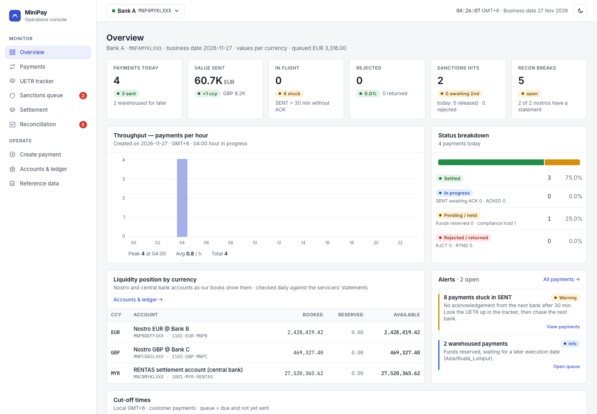

### Payments and a payment's detail
The payments list by status. One payment: its lifecycle step by step (with each step's evidence), the
sanctions screening, and the route as the UETR tracker sees it, with every bank's deduction.

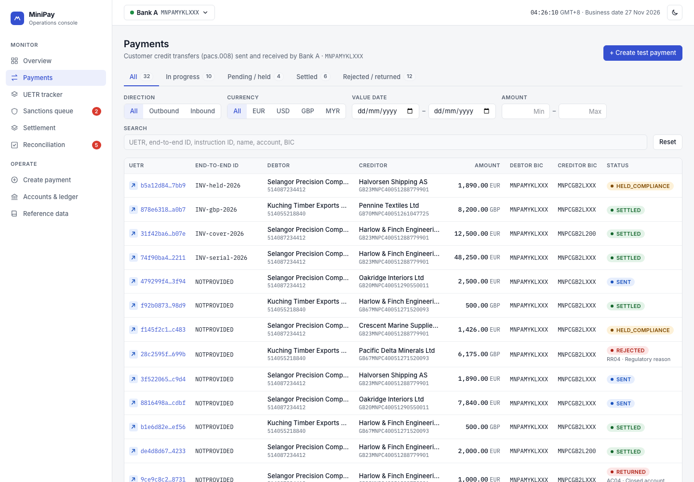
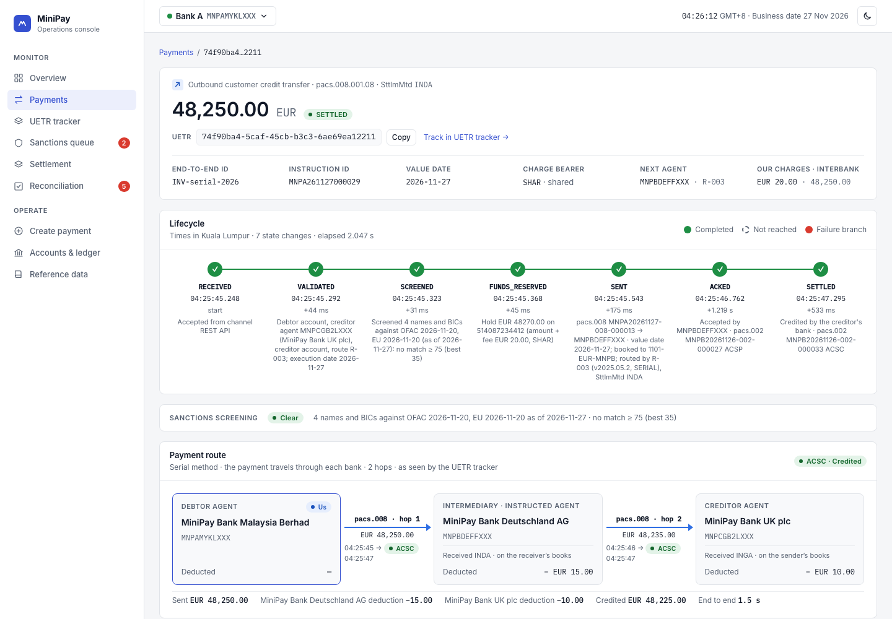

### UETR tracker
Any payment the network carried, end to end: hops, confirmations, deductions, cover legs and returns,
from every bank's messages.

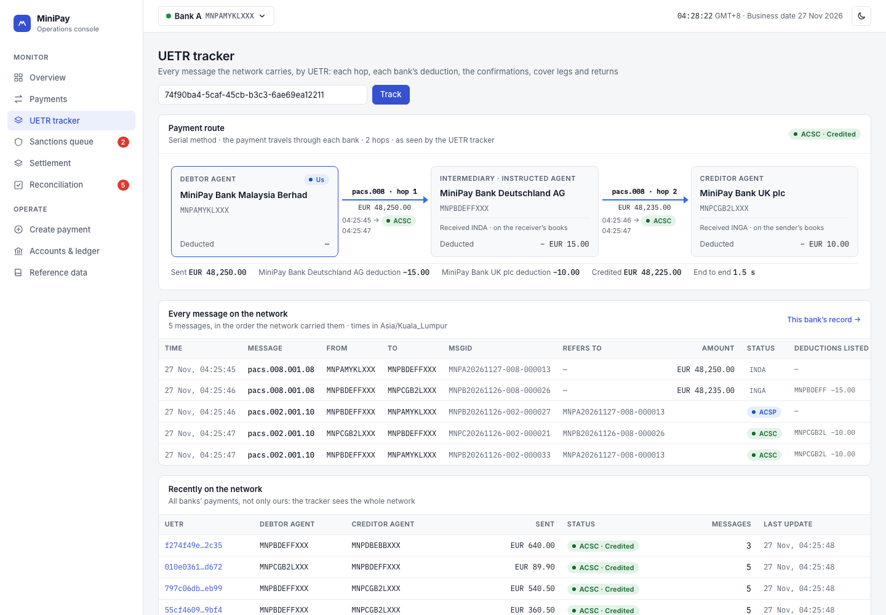

### Sanctions queue
Payments held by screening, the hit explained (matching words, attribute comparison, score breakdown,
engine hint), and the decision with four-eyes release.

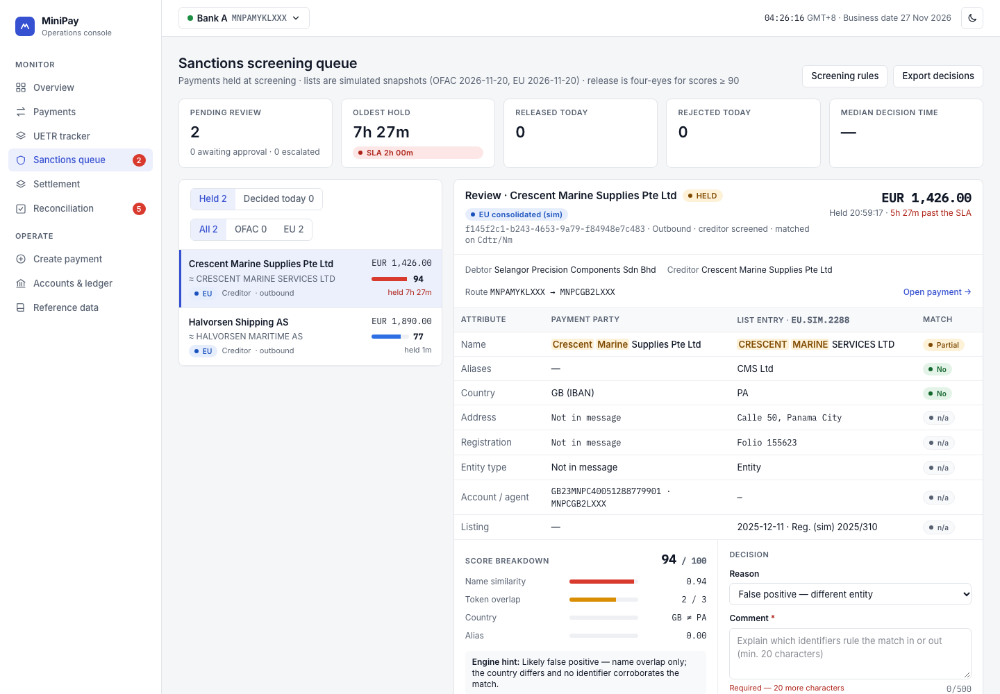

### Settlement
Read from the central bank, as a bank sees T2 through T2's own screens:

- **RTGS:** the T2 account, the queue, the intraday balance, the cut-off.
- **Deferred net:** a MiniPay Net cycle's obligations matrix, net positions and netting efficiency.
- **Instant:** the live feed counting down to the 10-second timeout.

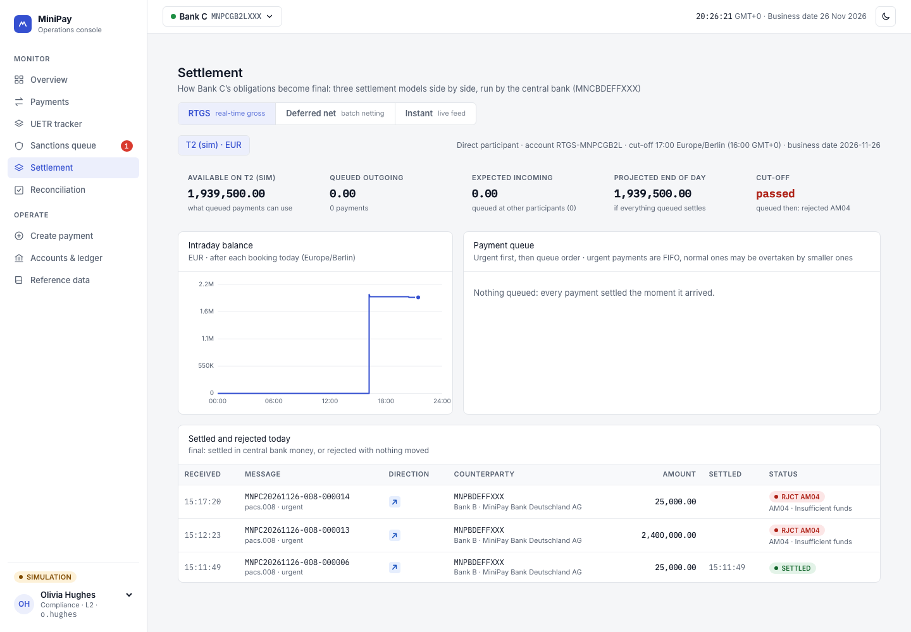
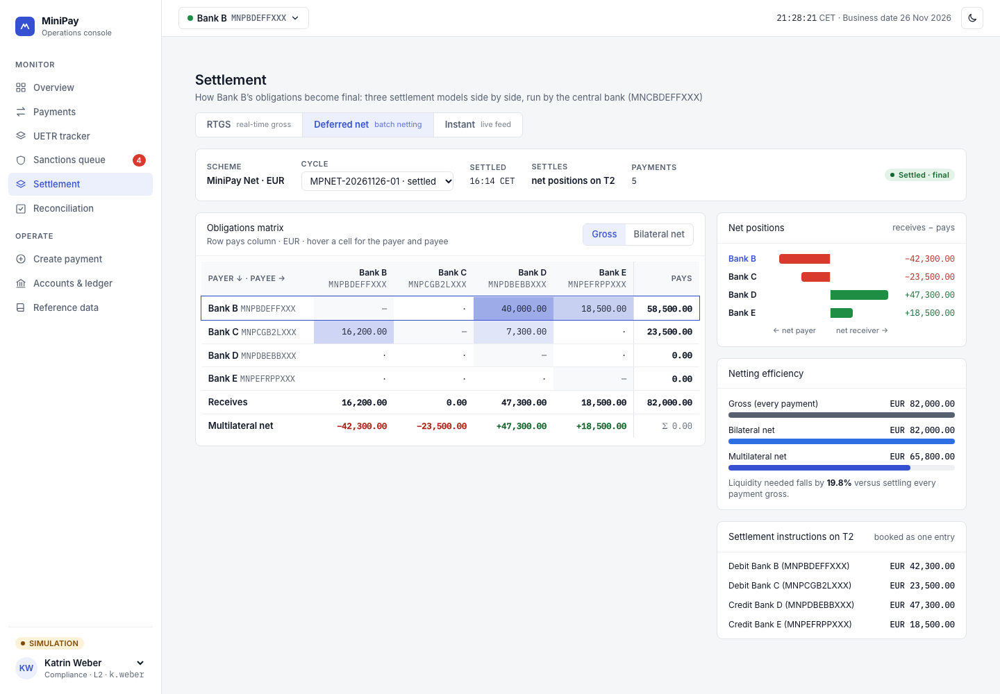
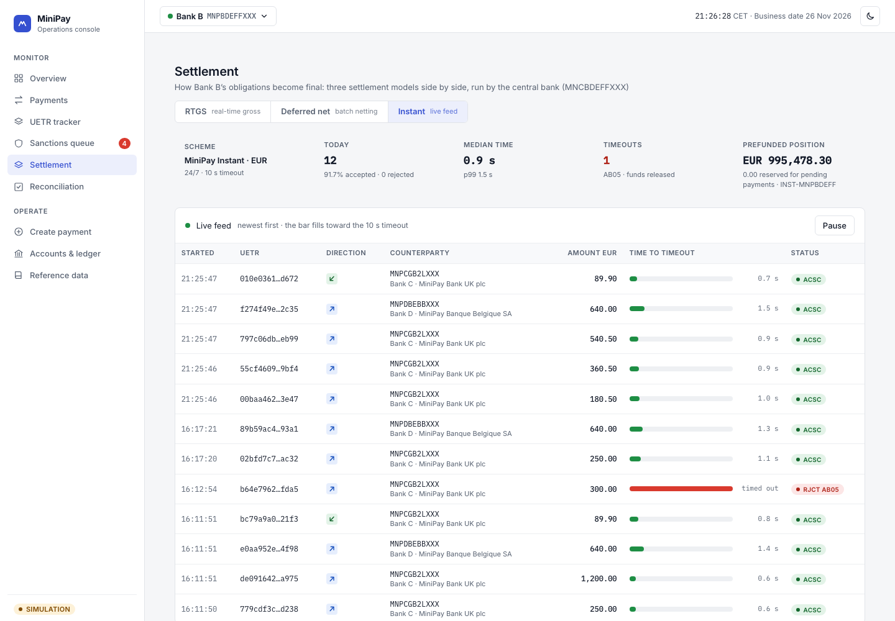

### Reconciliation
A nostro against its servicer's camt.053:

- the statement, the match rate and the balance proof;
- the matching table by rule, here a DNS cycle's net entry matched against its four gross payments, next
  to the entry's XML;
- the breaks, with suggested resolutions.

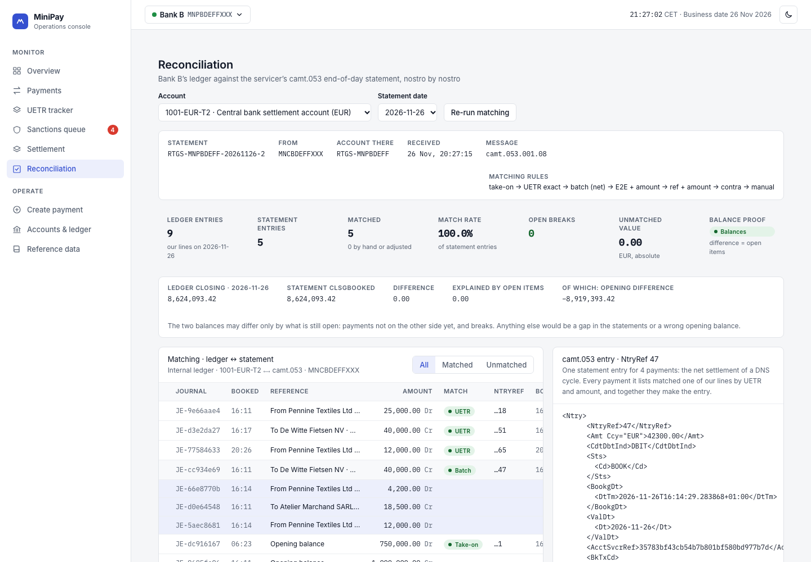

### Create payment, Accounts & ledger, Reference data
- **Create payment:** a payment form with scenario presets, service level, and the pacs.008 it would
  produce.
- **Accounts & ledger:** booked, reserved and available balances; statements per business date; holds;
  the integrity check.
- **Reference data:** the BIC directory, IBAN check and routing rules, as of any date.

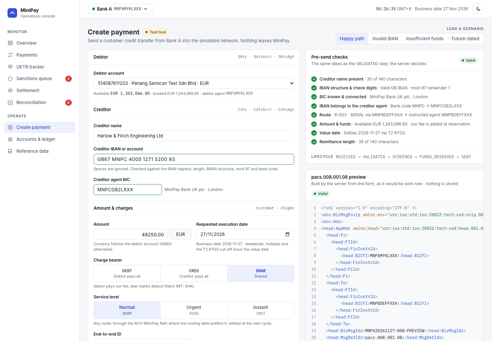
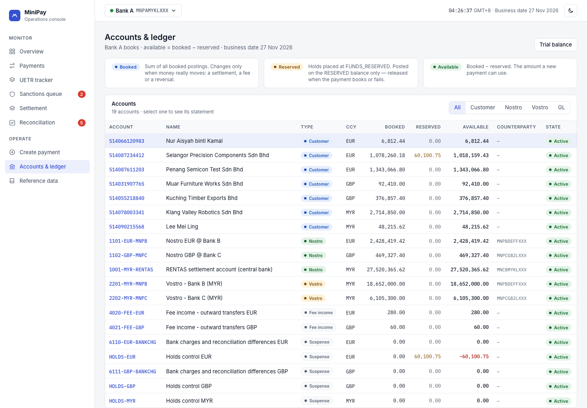
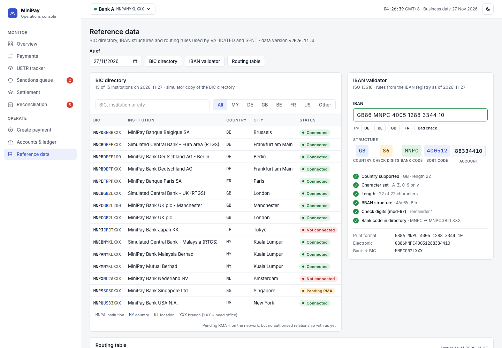

## Tests

```bash
cd backend && ./mvnw verify                                        # everything below
cd frontend/ops-console && npm run build && npm run lint           # type-check, production build, oxlint
```

| Kind | Naming | What |
|---|---|---|
| Unit | `*Test` | domain logic without Spring: Money, state machines, route selection, value dating, IBAN checks, name matching, queue policy, netting, statement matching, message round trips, MT103 translation |
| Integration | `*IT` | each module against real PostgreSQL (Testcontainers, never H2): idempotency, database guards, concurrency, crash safety |
| End to end | `NetworkE2EIT` | the four institutions in one JVM over one Kafka (each with its own PostgreSQL), driven through the network only: serial, cover, direct, return, rejection, compliance holds at every bank, T2, a DNS cycle, instant (accepted and timed out), a return through T2, and every nostro reconciled |
| Architecture | `ModuleBoundariesTest` | ArchUnit: no module touches another's `internal`, no cycles, Kafka only in the outbox relay and the network inboxes |

The concurrency and crash-safety tests were each proved by mutation: remove the lock, the derived key
or the replay they protect, and the test fails. `NetworkE2EIT` passes its overrides as command-line
arguments, because those outrank the profiles' own settings (ports, datasource, Kafka). CI
(`.github/workflows/ci.yml`) runs the backend build and the console's build and lint on every push.

## What you should learn from M1 (ledger)

**Double entry, and why a customer debit is a decrease.** Every event is recorded twice: once
on each side. Each account type has a *normal side*:
- A customer account is a **liability**: it is money the bank owes. A debit lowers it.
- A **nostro** ("ours, with you") is our money at another bank, an **asset**. A debit raises it.

So "pay EUR 100 abroad" is *debit customer, credit nostro*. Both balances go down, and the books
still balance. Look at the statement footnotes in the console, and at `AccountType.normalSide()`.

**Nostro and vostro are two views of one relationship.** Bank A's nostro `1101-EUR-MNPB` and
Bank B's vostro for Bank A (`DE87…2003`) hold the same EUR 2,899,613.17. Every cross-border
payment moves both, and checking that they still agree is nostro reconciliation (M8, the
Reconciliation screen).

**Booked, reserved, available.**
- *Booked* is what has really happened.
- *Reserved* is money promised to payments in flight.
- *Available = booked − reserved* is what a new payment may use.

A hold is recorded as balanced postings on a separate RESERVED balance, against a per-currency
holds control account. It is auditable, yet it never appears on the customer's statement.
Settling a hold is *release + book* in one transaction, so available does not move a second
time.

**History is immutable.** Postings can't be updated or deleted, and the database enforces it.
A mistake is fixed with a reversal entry that points to the original, so auditors see both the
mistake and the correction. Balances, on the other hand, are derived data: the end-of-day check
recomputes them from postings and proves they match.

**Correctness under concurrency is designed, not hoped for.**
- Locking the balance rows with `FOR UPDATE` stops two debits from reading the same balance and both succeeding: 100 parallel debits of EUR 10 against EUR 500 give exactly 50 successes.
- Always locking in account-id order makes A→B and B→A wait instead of deadlocking.

Both properties have tests, and those tests fail if the locking is broken.

**Retries are normal; double-posting is not.** Clients time out and resend. The
Idempotency-Key, plus a hash of the request, turns a resend into a replay of the original
answer. Reusing a key for a *different* request is a client bug, so it gets a 422.

**Refusals speak ISO 20022.** Refusals return the reason codes a bank would put in a pacs.002:
AM04 (insufficient funds), AC01 (unknown account), AC04 (closed), AC06 (blocked), AM03
(currency not allowed). When the payment hub arrives in M2, these flow straight into payment
rejections.

**Time is two different things.** Booking time is a UTC timestamp. The *value date* and the
*business date* are calendar dates in the bank's time zone. Bank A's "today" ends at midnight
in Kuala Lumpur, not at midnight UTC.

## What you should learn from M2 (payment hub)

**A payment is a state machine, and the states guard money.** RECEIVED → VALIDATED → SCREENED →
FUNDS_RESERVED → SENT → ACKED → SETTLED. Every jump is checked against one table; an illegal one
throws. A payment can be REJECTED only *before* it leaves the bank. Afterwards the only way back is
a RETURN (pacs.004), and only once it has settled.

**Rejected is a result, not an error.** A well-formed payment with an unknown account, the wrong
currency or too little money is *stored* and REJECTED with an ISO reason code (AC01, AM03, AM04…).
The bank can then tell the customer exactly why. Only malformed input gets an HTTP 400.

**Three amounts, not one.** The *instructed* amount is what the customer asked for. The *interbank
settlement* amount is what moves between banks. Our *charges* are what we keep. The charge bearer
(DEBT, SHAR or CRED) decides how they relate. Under SHAR, the debtor pays amount + our fee. Under
CRED, our fee comes out of what is sent. A return can bring back less than was sent, because banks
on the route keep their charges.

**Correspondent banking in one routing rule.** Bank A holds no EUR account at Bank C, so a EUR
payment to London goes to Bank A's EUR correspondent, Bank B, and is booked against the nostro
there. That is the serial method. If the creditor's bank holds a vostro with us, we simply credit
it.

**Crash safety comes from idempotent steps.** Each step calls the ledger with a key derived from
the payment and the step (`pay:{id}:reserve`). If the process dies between "ledger done" and
"status saved", re-running the step replays the ledger result instead of booking twice. Ten workers
racing on one payment produce exactly one hold, one booking and one fee.

**The transactional outbox.** "Update the database, then publish to Kafka" loses messages when the
process dies in between. Instead, the event is written to an outbox table *in the same transaction*
as the status change, and a relay publishes it afterwards. Delivery is therefore *at least once*: a
crash after Kafka acknowledged but before the row was marked sends the event again. That is why
every event carries an `event-id`, and why consumers must de-duplicate.

**Optimistic and pessimistic locking, side by side.** One payment rarely sees two writers, so it
uses `@Version`, and the loser of a rare race just retries. One ledger account can see hundreds of
writers, so the ledger locks rows. Pick the lock for the contention you actually have.

## What you should learn from M3 (reference data)

**Facts have dates.** A bank is renamed on 2 October, a route changes on 1 December, a BIC disappears
at year end. So every row is valid over a date range, and every question is asked "as of" a date.
Nothing is overwritten. A change is a new row, and the old one is end-dated. PostgreSQL enforces both
halves: an `EXCLUDE` constraint makes two versions on the same day impossible, and a trigger refuses
any update other than shortening a validity.

**The date that matters is the day the money moves.** A payment warehoused for next week is checked
against next week's directory and routed by next week's rules. Bank A pays Paris serially via Bank B
until 30 November, and by cover from 1 December. The route a payment took is stored with it (R-005,
R-006), so it can be explained later.

**Format-valid is not the same as valid.** `MNPZDEFFXXX` is a perfectly shaped BIC of a bank that does
not exist (RC01). `GB97 MNPC…` fails mod-97 by one digit (AC03). A valid IBAN of a London bank, sent
to a Brussels bank, is rejected too (AC03): one of the two is wrong, and guessing could pay the wrong
bank.

**Business days and cut-offs belong to the currency.** A EUR payment needs a TARGET business day
before T2's cut-off, and 17:00 Frankfurt time is 00:00 or 23:00 in Kuala Lumpur depending on the
season. Store the cut-off in the scheme's time zone and convert at the moment of use. Requested dates
on a weekend or holiday roll forward to the next business day. A payment that misses the cut-off still
leaves now, with the next value date.

**Routing is a decision, and decisions are explicit.** The lowest priority wins. A rule that cannot be
used (receiver not connected, settlement account closed) rejects the payment CNOR, instead of quietly
falling through to some other route.

**Retries must ask the same question.** The ledger booking includes the value date. A retry after the
cut-off must reuse the date already booked, or the ledger sees a different request under the same
idempotency key and refuses it.

**Reference data is governed.** It arrives in releases, each published by one person and approved by
another (four eyes; the database refuses self-approval), and is never back-dated.

## What you should learn from M4 (messaging)

**A payment between banks is a message.** The pacs.008 carries everything the next bank needs: UETR,
amounts, charge bearer, parties, agents, and how settlement works. `SttlmMtd` INDA means "debit my
account with you"; INGA means "I credit yours with me". The answers are messages too: a pacs.002 with
a status (ACCP, ACSC, RJCT) and a pacs.004 that brings money back, minus what the banks kept.

**A message has a header and a body.** The Business Application Header says who sends what to whom,
under which rules (CBPR+). The Document says what. Both must agree, and the receiver checks.

**Keep the bytes.** What you sent and what you received are evidence, so the raw text is stored
untouched and the database checks its hash. Parsed columns are an index into it, never a replacement.
Even an invalid message is kept: it is the one you will be asked about.

**"Did I already see this?" has two answers.** Outbound, a business key ("the pacs.008 for this
payment") makes a retried step get back the message it already sent. Inbound, the sender's MsgId
identifies a message, so a resend is recognised and not acted on twice. Networks also deliver out of
order: an old status must never move a payment backwards.

**MT and MX are not the same information.** MT103 has 35-character lines, a restricted character set
and no end-to-end id. A translation from MX loses or reshapes information, and a translation back
cannot restore it. The translator says field by field what was kept, transformed, truncated or lost.
That is why CBPR+ limits InstrId to 16 characters while both formats are in use.

**Statements are written for the account holder.** A camt.053 for a vostro tells the other bank what
moved on its account with us. That bank compares it with its own nostro: that comparison is
reconciliation (M8).

## What you should learn from M5 (network)

**A payment between banks is a chain of bilateral steps.** Bank A only talks to Bank B, and Bank B to
Bank C. Each bank books its own leg on the account it shares with its neighbour, takes its charge,
passes the payment on, and answers the bank before it. No bank ever sees another bank's books. What
holds the chain together is the UETR, carried unchanged from end to end.

**Settlement method says whose books move.** INDA: "debit my account with you". INGA: "I credited
your account with me". CLRG: "through the RTGS". COVE: "the money comes separately". The receiving bank
reads it to know which account the money arrives on.

**Charges shrink the payment hop by hop.** Under SHAR, Bank B keeps 15 and Bank C keeps 10, so 1000
sent becomes 975 credited. Every bank adds its deduction to ChrgsInf, so whoever reads the message (or
the tracker) can explain the difference to the cent.

**Outcomes come back the way the payment went.** A confirmation, a rejection or a return travels back
through every bank in between, and each bank does its part: relay the ACSC; reverse its booking and
relay the RJCT; book the return back and pass it on. Nothing is ever deleted: a reversal is a new
entry.

**Cover: the payment and the money take different roads.** The pacs.008 goes straight to the
creditor's bank, and the pacs.009 goes to the correspondent, who moves the money and notifies the
creditor's bank (camt.054). The creditor's bank must not pay out until the money is there. It also
cannot count on the order the two messages arrive in.

**The network delivers at least once, in no particular order.** Every receiver must cope with
duplicates (event id, MsgId) and with late or out-of-order answers, which must never move a payment
backwards.

**A tracker is an observer.** Like the gpi Tracker, it reads every message and builds the end-to-end
picture: hops, deductions, confirmations, cover legs, returns. It never takes part in the payment.

## What you should learn from M6 (compliance)

**Screening happens before money moves, at every bank.** An outgoing payment is screened before its
funds are reserved, an incoming one before anything is booked. So a held payment costs nothing to
reject. No bank relies on another bank's screening: the same payment can be held at Bank A, then at
Bank B, then at Bank C.

**Matching names is fuzzy, and must be explainable.** "Oakridge Interiors Ltd" is not "OAKRIDGE
INTERIORS TRADING FZE", but it is close enough to look. The engine:

- ignores legal forms;
- tolerates spelling, word order and split words;
- weighs generic words (TRADING, MARINE) less.

It then shows the analyst why it scored what it did: the matching words, the factors, the list entry
side by side, and a hint. A different country never lowers the score: listed parties bank anywhere.

**Lists are dated.** An entry is listed from one day and delisted on another. The screening records
which list snapshot and which date it used, so "why did this payment pass in March?" has an answer.

**Four eyes.** Letting a strong hit go needs two people, and the database refuses an approval by the
person who released it. Every decision carries a reason and a comment of at least 20 characters,
because the comment is the audit trail.

**Say little when you refuse.** A rejection goes back as RR04, "regulatory reason", and nothing
more: telling the sender it hit a sanctions list could tip off the listed party.

**A decision resumes the payment, and the decision is the truth.** The hub hears about the decision
through an event. If that event is lost, the recovery sweeper finds the released payment anyway.

## What you should learn from M7 (settlement)

**Interbank money moves on someone else's books.** Between correspondents it moves on nostro and vostro
accounts. In a settlement system it moves on accounts at the central bank, which keeps the only set of
books that counts. That is why the simulator has a fourth instance. Each bank keeps a mirror of its
account there, and the mirror must match: reconciliation (M8) checks it.

**Gross, net, instant: three answers to "how much liquidity, and when is it final?"**

- **T2 (RTGS)** settles every payment on its own, at once, final. It needs liquidity for every payment.
  When there is not enough, the payment waits in a queue: urgent first and strictly in order, normal
  ones overtaken by smaller ones. Liquidity flows on: one bank's incoming payment releases its own
  queued payments, which release the next bank's. At the cut-off, whatever still waits is rejected.
- **MiniPay Net (DNS)** collects payments and settles only each bank's net position, once per cycle. In
  the end-to-end test, 5,000 of payments need 3,000 of liquidity. The price:
  - nothing is final until the cycle settles;
  - a bank that cannot pay its position is unwound, and its counterparties may then be short in turn.
    That is the systemic risk central banks worry about.
- **MiniPay Instant** settles in seconds, at any hour, on positions placed in advance (prefunding). The
  payee must answer within 10 seconds, or the payment is rejected (AB05) and the money released. A
  sanctions hit cannot be cleared that fast.

**V-shape.** The payer bank addresses its pacs.008 to the system, with the creditor's bank as InstdAgt.
The system settles first, then forwards the same Document, byte for byte, under its own header. So a
payment that reaches the creditor's bank is already final. If that bank cannot apply it, it cannot
reject it: it can only return it (pacs.004) through the system.

**The service level picks the system.** Normal payments go the cheapest way (the ACH), urgent ones
never wait for a cycle, instant ones go only through the instant scheme. The routing table ranks the
methods. The service level says which methods a payment may use at all.

## What you should learn from M8 (reconciliation)

**Every nostro exists twice, and only one copy is the truth.** Our nostro is our record of an account
the correspondent keeps. Every day its statement (camt.053) is compared with our books. Whatever does not
agree is a break, and someone owns it until it is explained.

**Match on the payment's own keys, strongest first.** The UETR is unique per payment and travels
unchanged, so most entries match on it alone. After that, in order:

- a batch: one net entry against the many payments it lists, as a DNS cycle settles them;
- the end-to-end id;
- the servicer's reference;
- contra pairs that cancel out, such as a payment sent and then reversed.

Points of view flip on the way: our Dr is the servicer's CRDT.

**Most breaks are time.** We book a payment today; the servicer books it after its cut, or on its own
date. Matching therefore works on open items carried forward, and a timing break clears by itself
when the next statement shows the payment. The breaks that remain need people:

- a charge we never booked: book it;
- a payment booked twice: claim it back;
- an amount that differs: find who deducted what.

**Prove the balance.** The two closing balances may differ only by the open items. If they differ by
more, a statement is missing or the opening balances never agreed, and no amount of matching fixes that.

## Milestones

| | Milestone | Status |
|---|---|---|
| M0 | Foundation: modules, Compose, Flyway, Money/UETR/BIC, ADR-001, CI | ✅ |
| M1 | Ledger: double entry, append-only, holds, locking, idempotency, integrity, Accounts screen | ✅ |
| M2 | Payment hub: idempotent payment API, state machine, history, outbox + Kafka relay, crash safety, Payments screens | ✅ |
| M3 | Reference data: effective-dated BIC directory, IBAN registry, routing rules, holidays, cut-offs; Overview and Reference data screens | ✅ |
| M4 | Messaging: pacs.008/002/004, camt.053, MT103 ↔ pacs.008 with loss report, raw store; Messages tab, pacs.008 preview | ✅ |
| M5 | Network simulator: 3 banks over Kafka, incoming payments, hop-by-hop outcomes, serial and cover, UETR tracker; Payment route and tracker screens | ✅ |
| M6 | Compliance: sanctions screening at every bank against dated lists, explainable fuzzy matching, cases, four-eyes release, RR04; Sanctions queue screen | ✅ |
| M7 | Settlement: a simulated central bank running T2 (RTGS queue, cut-off), MiniPay Net (cycles, netting, unwinding) and MiniPay Instant (prefunding, 10 s timeout); service levels; Settlement screen | ✅ |
| M8 | Reconciliation: end-of-day camt.053 from every servicer (batch entries for DNS cycles), matching by UETR, batch, E2E, reference and contra on open items, breaks with carry-forward, adjustment and claim, balance proof; Reconciliation screen | ✅ |
